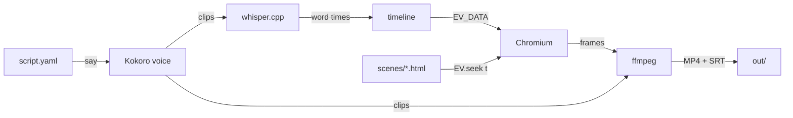

# How it works

The voice sets the clock, the picture is web code, and a headless browser draws each frame. Commands are in [reference.md](reference.md).

## Pipeline

| Tool | Job |
|------|-----|
| Kokoro v1.0 (kokoro-onnx 0.6.1) | Speaks each beat on your CPU. US and UK English voices. |
| whisper.cpp 1.9.5 | Listens to each clip: flags words the voice got wrong, and gives the time of every word. Speech to text only; it does not make the voice. |
| Headless Chromium (Playwright 1.63) | Opens each scene page, moves it to time t, and takes a screenshot, once per frame. With `engine: hyperframes`, it only lints the beat frames. |
| HyperFrames 0.8.157 (optional engine) | Captures every frame in parallel Chrome workers, and seeks `<video>` clips frame by frame. See [Engines](#engines). |
| EV runtime (`ev/web/ev.js`, this repo), rough.js 4.6, KaTeX 0.19 | GSAP-style tweens computed from time, captions, and layout lint; hand-drawn shapes; math. All inside the page. |
| ffmpeg | Encodes frames, joins scenes, mixes the voice, and writes the MP4. |
| Docker | Holds all of the above, so every machine gets the same result. |

## The clock

1. `make narrate` speaks each beat and saves the clip length and the time of every word.
2. A beat starts when the beat before it stops talking, plus `gap`, plus `hold` if the beat before sets one.
3. The renderer gives each scene page these times in `window.EV_DATA`. `EV.at("beat", "word")` returns the second the voice says that word.
4. For every frame (30 per second), the renderer calls `EV.seek(t)` and takes a screenshot.

Picture and voice cannot drift apart. If an animation needs more time, add `hold` to its beat.

## Engines

Set `engine:` in `script.yaml`. Both engines run the same scene pages and the same `EV` runtime, so you do not change the scenes.

| | `playwright` (default) | `hyperframes` |
|---|---|---|
| Captures frames | One page, one screenshot per frame | `hyperframes render`, parallel Chrome workers |
| `<video>` clips in a scene | Not seeked: do not use | Seeked frame by frame ([scenes.md](scenes.md#video-clips)) |
| Lint and review stills | From the capture | Playwright lints the beat frames; stills are cut from the MP4 |
| 720p preview | Drawn at 720p | Drawn at 1080p (fast preset), then scaled to 720p |

How the `hyperframes` engine works:

1. `make preview` copies the scene's files into `build/hf/<scene or all>/`, a HyperFrames project.
2. It wraps the page body in a composition root (`#ev-root`) with the scene's size and length, and inlines `EV_DATA`.
3. `EV.ready()` registers `EV.seek` as a HyperFrames frame source. HyperFrames then owns the clock and calls `EV.seek(t)` for each frame.
4. The renderer checks the MP4 has exactly the frames the voice needs, then joins the scenes and mixes the voice as usual.

**Privacy.** The image turns off HyperFrames telemetry, update checks, and auto-installs (`HYPERFRAMES_NO_TELEMETRY=1`, `DO_NOT_TRACK=1`). The pipeline never calls the commands that upload (`publish`, `cloud`, `lambda`, `auth`), and never sets `GEMINI_API_KEY`, which makes `hyperframes snapshot` send frames to Gemini.

**Speed.** Measured 2026-10-14 on a 10 s video of 2 scenes (Colima, 4 CPUs, 8 GB, Apple Silicon):

| Quality | `playwright` | `hyperframes` |
|---------|--------------|---------------|
| 720p | 11 s | 21 s |
| 1080p | 12 s | 21 s |

HyperFrames starts Chrome once per scene, so short scenes favor `playwright`. ⚠️ Unverified: whether its parallel workers win on long scenes. Set `EV_HF_WORKERS=2` (for example `EV_HF_WORKERS=2 make preview SLUG=dns`) if Docker has little memory; each worker is a Chrome of about 256 MB (HyperFrames docs).

**Browser.** HyperFrames uses Playwright's Chrome headless shell. Google builds no headless shell for Linux ARM64 (Apple Silicon under Docker), and one browser keeps both engines the same.

Switching the engine cancels the preview approval (it changes the picture), but not the plan approval.

## Why animation as web code

- **Any look.** Diagrams, UI mockups, maps, charts, code, icons, hand-drawn whiteboard, and math all fit.
- **Agents write it well.** Language models are strong at HTML, SVG, and CSS.
- **The preview is the video.** 720p and 1080p use the same page size in CSS px and differ only in pixel density, so the layout you approve is the layout you get.
- **Not Manim:** it fits math, not every topic. **Not Remotion:** larger companies need a paid company license (⚠️ check remotion.dev/license).

## Automatic checks

- **Voice:** whisper.cpp compares what it heard with the script. A beat under 85% match prints `CHECK`. Spelled-out numbers ("two percent" heard as "2%") do not count as misses.
- **Layout lint:** on the frame before each next beat, `EV.lint()` reports text outside `.safe`, text under 28 px, and overlapping text, as `LINT` lines.
- **Timing:** a scene whose animation runs past its voice prints a `LINT` line.
- **Page errors:** any JS error stops the render and prints the message.
- **Review frames:** the same frames go into labelled contact sheets of 12, each listed with its `show:` line, so a person or an agent checks a whole video in a few images.

## Captions

Captions are part of the design, not a layer on top:

- **In the picture.** `ev.js` draws them in the look's font and colors, in a band below `.safe`, so they never cover content.
- **Timed to the voice.** With `captions: pop` (default), each word appears as the voice says it and pops, then settles. With `captions: line`, the whole line shows and words light up. `captions: off` removes them from the picture.
- **Key words.** Words in `*asterisks*` in `say` take the key color. The voice ignores the asterisks.
- **Switchable track.** Each MP4 also carries a subtitle track (off by default) that players can switch on, and `out/` gets `.srt` and `.vtt` files for uploads and web players.
- **Clickable transcript.** The dashboard player lists the caption lines; click one to jump there.

## Open source

Every tool in the pipeline has an open-source license.

| Part | License |
|------|---------|
| Kokoro-82M voice model, kokoro-onnx | Apache-2.0, MIT |
| espeak-ng, phonemizer (pronunciation, used by kokoro-onnx) | GPL-3.0 |
| whisper.cpp and its Whisper models | MIT |
| Playwright, headless Chromium | Apache-2.0, BSD-3-Clause |
| HyperFrames CLI (`hyperframes` on npm), Node.js 22, chrome-headless-shell | Apache-2.0, MIT, BSD-3-Clause |
| HyperFrames npm dependencies (70 packages, checked 2026-10-14) | MIT, Apache-2.0, ISC, BSD-3-Clause, 0BSD, CC0-1.0; libvips (through sharp) LGPL-3.0 |
| rough.js, KaTeX, three.js, onnxruntime, PyYAML | MIT |
| ffmpeg (Debian build) | GPL |
| Inter, Noto, Noto Color Emoji, JetBrains Mono, Caveat fonts | SIL Open Font License |
| Liberation Sans Narrow font (the `instrument` moodboard) | GPL-2.0 with a font exception |
| Basecoat CSS (the dashboard) | MIT |
| Python, numpy, soundfile, Pillow | PSF, BSD, BSD-3-Clause, MIT-CMU |
| Colima or Docker Engine | MIT, Apache-2.0 (Docker Desktop is not open source) |

The coding agent is your choice: [AGENTS.md](../AGENTS.md) works with any agent. The Claude skill and the dashboard are optional extras for Claude Code. This repo is MIT licensed ([LICENSE](../LICENSE)); [THIRD_PARTY.md](../THIRD_PARTY.md) lists the material it holds or adapts from other projects.

## Caching

- **Voice clips:** one per beat text, voice, and speed. Edit one beat, and only that clip is made again.
- **Scene renders:** one per scene page, style, timing, size, and engine. Edit one scene, and only that scene renders again.
