# Autopilot, pilots, and engineers in the LLM era: storyboard

Generated from script.yaml; edit that file.

Reading this as: The autopilot flies most of a flight, yet pilots still train to fly by hand because the human takes the hardest moments; with LLMs writing code, CS and SE fundamentals are the engineer's hand-flying skill. For: Software engineers, CS students, and tech colleagues who use AI coding tools; they know little aviation history.

## Picks

**Video format: `history-lesson`**
- Recommended: `history-lesson`: Its five acts follow the brief in order: Sperry to fly-by-wire, then AF447 and Bainbridge, then the 2013 FAA fix, then the LLM lesson for today.
- Alternative: `incident-review`: Engineers already know the blameless postmortem, so telling AF447 as timeline, cause, and what changed puts the lesson in their own terms.
- Alternative: `compare`: Shows pilot and autopilot next to engineer and LLM on the same criteria: who does the routine work, who takes over, and which skill fades.

**Moodboard: `instrument`**
- Recommended: `instrument`: Its cockpit readouts, attitude-sphere 3D, and amber-to-red alerts match the Sperry roll, the AF447 disconnect and stall, and the monitoring feel of part 3.
- Alternative: `blueprint`: White line art on a grid with 3D support suits the gyro and wireframe planes, and the engineering-drawing look suits an engineer audience.
- Alternative: `editorial`: A calm 2D fallback for a history and policy essay, from the Bainbridge quote to the FAA rule, if the user prefers no cockpit look.

## Video direction

- Moodboard `instrument`: A dark glass-cockpit screen with boxed readouts and strict alert colors, for aviation, operations, and incident timelines.
- Colors: bg `#0b1016` (background), ink `#e6edf3` (text), accent `#2ec7f0` (main idea), accent-2 `#ffb020` (second idea), good `#33d17a` (right, gain), bad `#ff3b30` (wrong, loss)
- Type: display Liberation Sans Narrow, body Inter, mono JetBrains Mono
- Motion: power2.out, 0.4 s, text enters by fade

Research: 49 claims, 1 with one source, 0 with none (research.md).

## Part 1: From gyro to autoland (57 s)

| # | Time | Voice | On screen | Treatment | 2D or 3D | Sources | Frame |
|---|------|-------|-----------|-----------|----------|---------|-------|
| opening/payoff | 00:00.0 | Pilots still train to fly by hand, even with an autopilot. Engineers need their basics with A I for the same reason. | Title in a thin box: AUTOPILOT, PILOTS, ENGINEERS. A mono status line below: PART 1/3 · FROM GYRO TO AUTOLAND. | title | 2D |  | 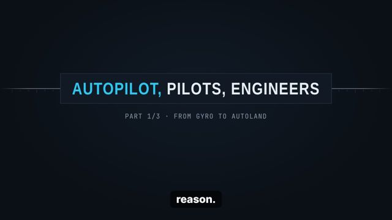 |
| sperry/hands | 00:08.6 | It starts in nineteen fourteen, near Paris. Lawrence Sperry flies past the judges with his hands in the air. | A cyan wireframe biplane flies level in a slow orbit. A boxed label: 1914 · PARIS. A tag appears: HANDS OFF. | stage-3d | 3D | c2, c3 | 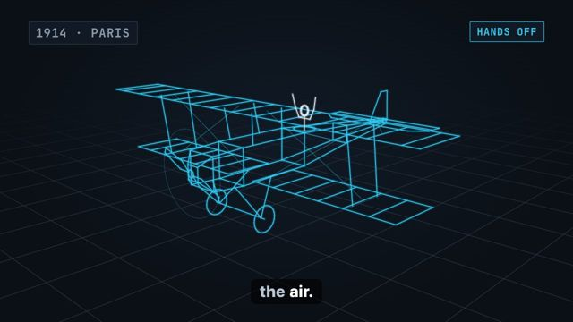 |
| sperry/wing | 00:16.2 | His mechanic walks out onto the wing. The gyro keeps the plane level. | A small marker moves out along one wing. The plane rolls a few degrees, then the wings return level. Label: GYRO STABILIZER. | stage-3d | 3D | c1, c3 | 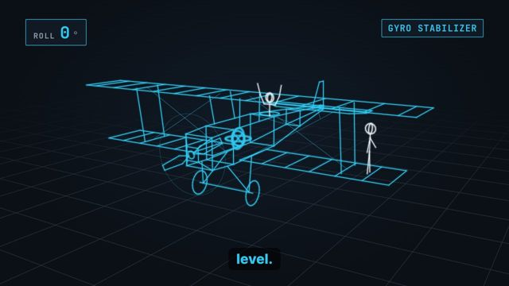 |
| milestones/post | 00:21.1 | In nineteen thirty three, Wiley Post flies alone around the world. His autopilot, Mechanical Mike, helps him. | A horizontal time tape slides in. Tick 1933 lights with a boxed label: MECHANICAL MIKE. A readout: 7 d 18 h 49 m. | timeline | 2D | c6, c7, c8 | 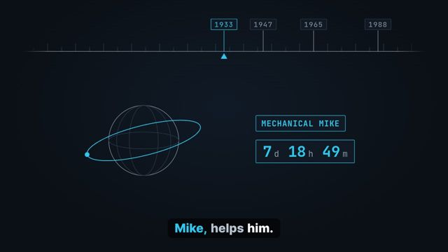 |
| milestones/atlantic | 00:29.3 | In nineteen forty seven, an Air Force plane crosses the Atlantic. It takes off and lands by itself. | Tick 1947 lights. A small route line draws from Newfoundland to England. Two boxed tags: AUTO TAKEOFF, AUTO LAND. | timeline | 2D | c4, c5 | 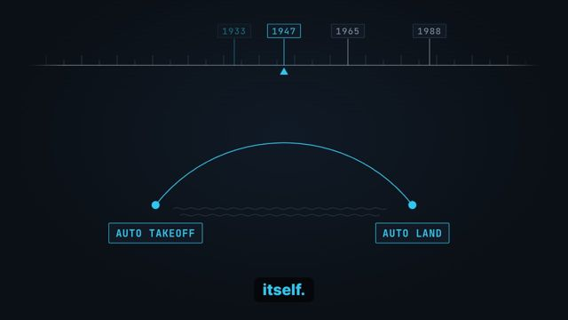 |
| milestones/autoland | 00:36.9 | In nineteen sixty five, a Trident airliner makes the first automatic landing on a passenger flight. | Tick 1965 lights. A runway icon with a glide line. Boxed label: FIRST AUTOLAND, PASSENGER FLIGHT. | timeline | 2D | c10 | 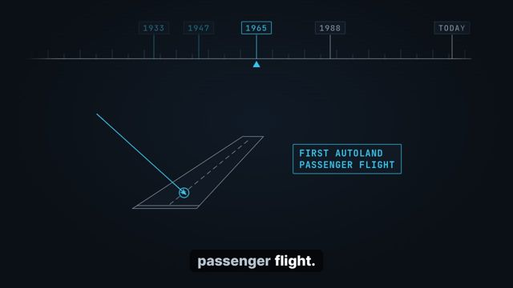 |
| milestones/flybywire | 00:44.0 | In nineteen eighty eight, the A three twenty enters service with digital fly by wire. | Tick 1988 lights. A boxed label: DIGITAL FLY-BY-WIRE. A thin line runs from a stick to a computer box to a wing. | timeline | 2D | c12, c13 | 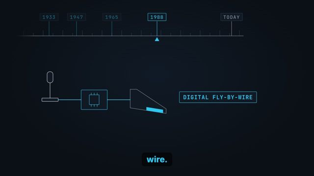 |
| milestones/today | 00:49.8 | Today, automation is on about ninety percent of the time. Next, why pilots still train so hard. | The tape slides to TODAY. A boxed mono readout counts up to 90 % with the label AUTOMATION ON. A small tag: NEXT · PART 2/3. | timeline | 2D | c14 | 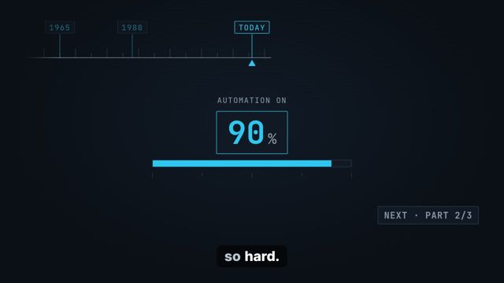 |

## Part 2: Why pilots still train (59 s)

| # | Time | Voice | On screen | Treatment | 2D or 3D | Sources | Frame |
|---|------|-------|-----------|-----------|----------|---------|-------|
| af447/context | 00:00.0 | Part two. What happens when the autopilot disconnects? | Badge PART 2/3. A cyan wireframe airliner cruises level against a dark sky, in a slow orbit. | stage-3d | 3D |  | 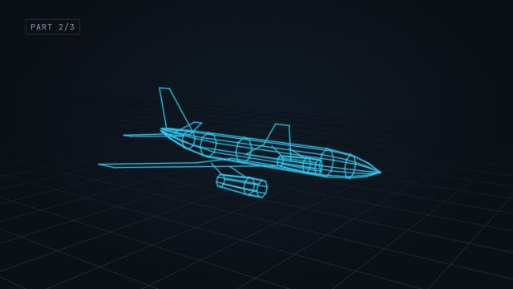 |
| af447/flight | 00:03.8 | In two thousand nine, Air France four four seven flies from Rio to Paris. | A boxed label: AF447 · 2009 · RIO → PARIS. The wireframe airliner holds level. | stage-3d | 3D | c20 | 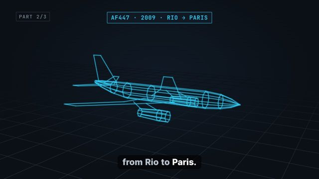 |
| af447/ice | 00:09.2 | Ice blocks the speed sensors. The speed readings disagree, and the autopilot disconnects. | Two boxed speed readouts show different values. An amber caution tag appears and stays: AUTOPILOT OFF. | stage-3d | 3D | c21 | 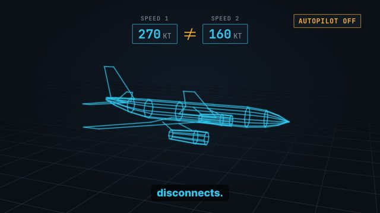 |
| af447/stall | 00:15.8 | The crew flies by hand, at high altitude. They do not recognize that the plane has stalled. | The airliner pitches nose up while a red arrow shows its path falling. A red warning tag appears and stays: STALL. | stage-3d | 3D | c22 | 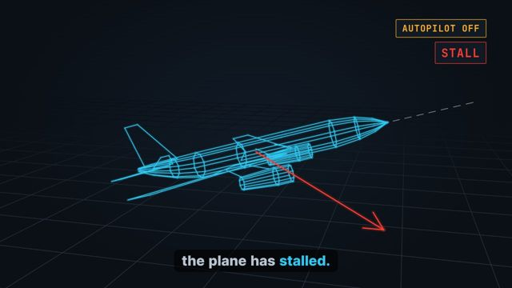 |
| af447/toll | 00:22.5 | All two hundred twenty eight people on board die. Investigators name a gap in hand flying training. | The 3D view fades. A boxed readout: 228 ON BOARD. A line below: GAP · HAND FLYING TRAINING. | stage-3d | 3D | c20, c23 | 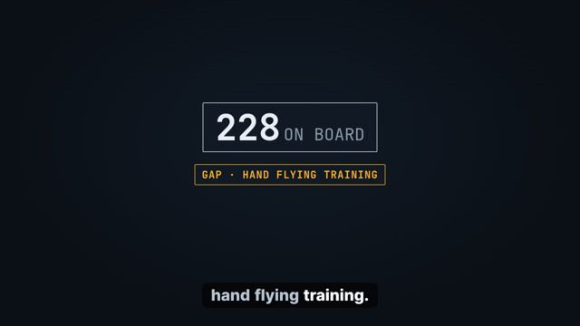 |
| irony/named | 00:29.6 | A nineteen eighty three paper calls this an irony of automation. | A boxed title: IRONIES OF AUTOMATION · BAINBRIDGE 1983. Two empty tapes appear side by side, labelled AUTOMATION and HUMAN. | compare | 2D | c24, c25 | 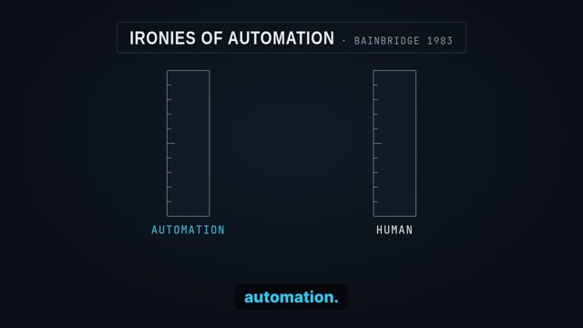 |
| irony/hardest | 00:34.2 | The automation does the easy parts. The human takes over only in the hardest moments. | The AUTOMATION tape fills with many cyan ticks, EASY. The HUMAN tape gets one amber tick, HARDEST. | compare | 2D | c25 | 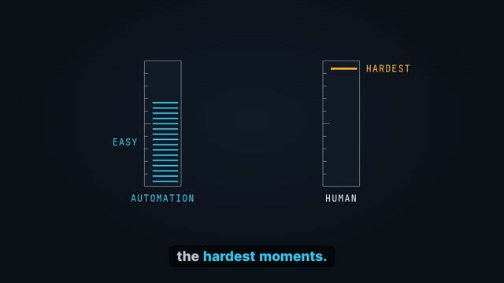 |
| irony/fade | 00:40.3 | And a skill that you do not use starts to fade. | A boxed readout HAND SKILL slides down its tape from high to low. | compare | 2D | c24 | 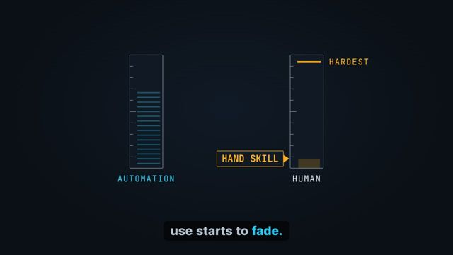 |
| fix/guidance | 00:43.5 | In two thousand thirteen, the F A A urges airlines to allow more hand flying. | A flow of three boxes appears; box 1/3 lights: FAA 2013 · MORE HAND FLYING. | flow | 2D | c26 | 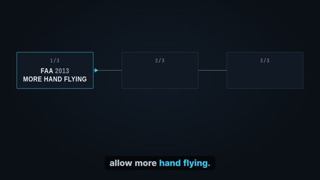 |
| fix/simulator | 00:49.2 | A new rule makes pilots train stall recovery in a simulator. | A cyan marker moves to box 2/3: SIMULATOR · STALL RECOVERY. | flow | 2D | c28 | 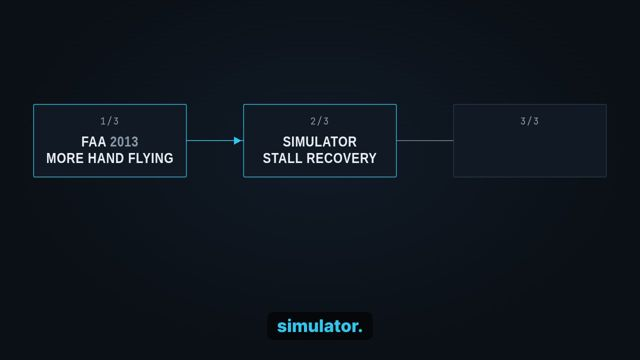 |
| fix/command | 00:53.6 | By law, the pilot stays the final authority. Next, the same lesson for code. | The marker moves to box 3/3: PILOT IN COMMAND. A small tag: NEXT · PART 3/3. | flow | 2D | c19 | 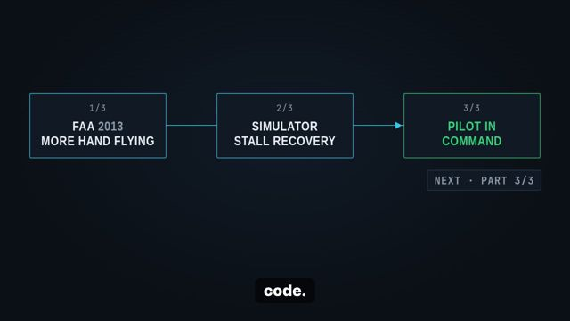 |

## Part 3: The same lesson for code (52 s)

| # | Time | Voice | On screen | Treatment | 2D or 3D | Sources | Frame |
|---|------|-------|-----------|-----------|----------|---------|-------|
| shift/context | 00:00.0 | Part three. Researchers now see the same irony in A I tools that write code. | Badge PART 3/3. Left box: AUTOPILOT. Right box: AI CODE ASSISTANT. A thin equals sign joins them. | compare | 2D | c40 | 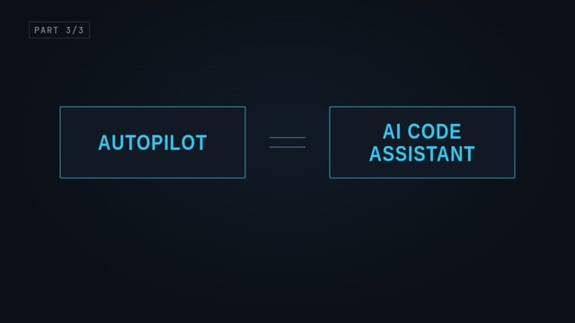 |
| shift/role | 00:05.5 | Your job shifts from writing code to checking it. | Two tapes: WRITE slides down, CHECK slides up. | compare | 2D | c41 | 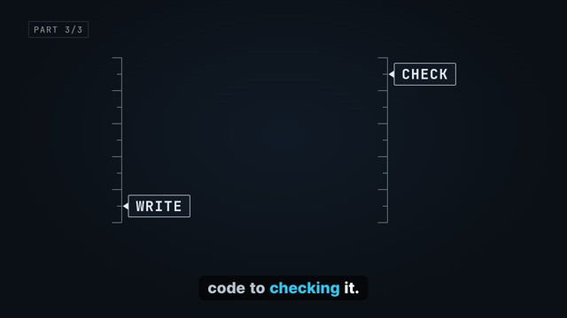 |
| shift/plausible | 00:08.7 | But a model can produce an answer that sounds right and is wrong. | A code card with a green-looking line and one amber tag: LOOKS RIGHT. The tag turns red: WRONG. | compare | 2D | c48 | 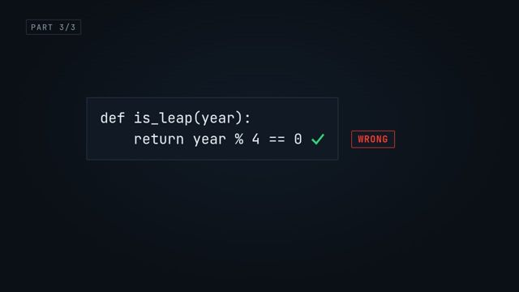 |
| evidence/quiz | 00:12.8 | In a twenty twenty six trial, developers learned a new library. With A I, they scored fifty percent on a quiz. Without it, sixty seven. | Two boxed readouts on one tape: WITH AI 50 %, WITHOUT AI 67 %. Small source line: Anthropic trial, 2026. | big-number | 2D | c34 | 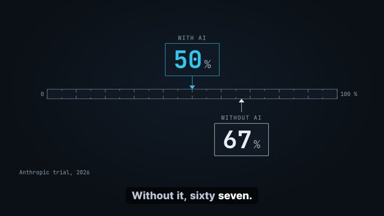 |
| evidence/debug | 00:22.4 | The biggest gap was in debugging, the skill you need when the code breaks. | A boxed tag lights on the gap between the two readouts: BIGGEST GAP · DEBUGGING. | big-number | 2D | c36 | 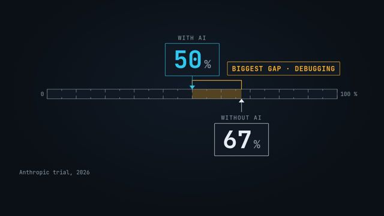 |
| evidence/confident | 00:27.0 | In a Stanford study, people with an A I tool wrote less secure code, yet felt more sure that it was safe. | Two dials side by side: SECURITY drops to amber, CONFIDENCE rises. Small source line: Stanford study. | big-number | 2D | c37 | 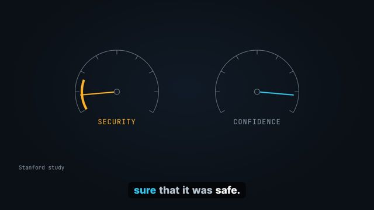 |
| basics/skills | 00:34.2 | So computer science and software engineering are your hand flying skills. They let you check, debug, and take over. | A flow of four boxes lights one by one: DATA STRUCTURES, DEBUGGING, SECURITY, SYSTEM DESIGN. | flow | 2D |  | 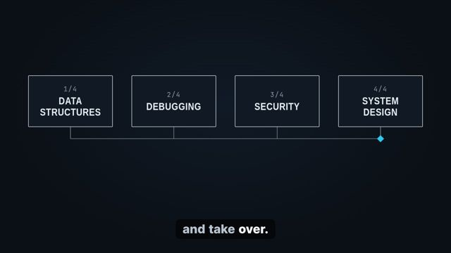 |
| basics/action | 00:42.1 | Use A I tools like an autopilot, with you in command. This week, fix one bug by hand first. Then ask the tool, and compare. | The boxes shrink into one line. A boxed mono tag: YOU IN COMMAND. Below: THIS WEEK · 1 BUG BY HAND, THEN COMPARE. | flow | 2D |  | 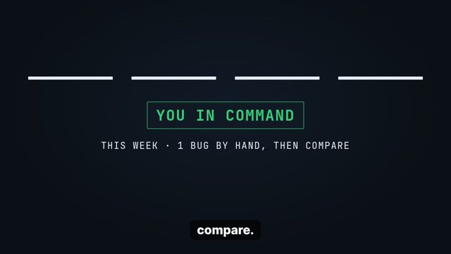 |
